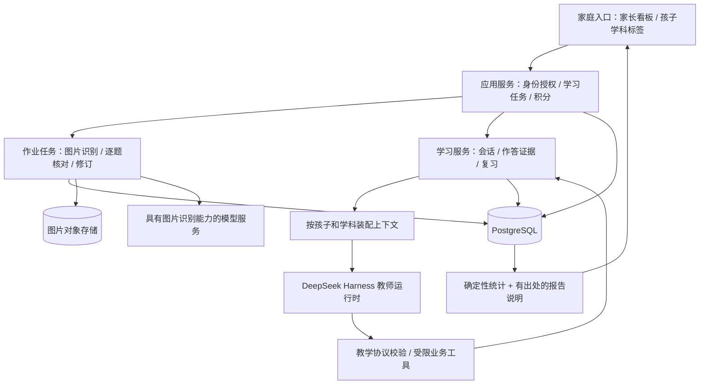

> 2026-11-19 范围变更：积分功能已移除，本文涉及积分、充值、扣费、退款及相关待确认事项均为历史设计，不再执行。当前状态以 README.md 为准。

# 家庭学习服务：错题本与学科老师整合方案 V1.0

日期：2026-11-13。状态：按龙哥最新决定修订，纯 C 端整体服务；已获授权在本地整合实现。旧项目仅作能力参考，不包含机构产品或机构对接路线；线上不改动。

## 1. 产品结论

问学直接面向家庭，家长注册、充值并管理孩子档案。**判作业、自主学习、错题巩固、复习与学习报告是一项整体服务**，共用身份、积分和学习记录。旧错题本提供上传与批改的实现经验。

家长购买的价值是减少陪作业时的盲目讲解、重复搜题和手工整理，同时知道孩子下一步该学什么。孩子得到的是有上下文、会引导、能接着上次继续的老师。

完整动线：拍作业 → 核对识别与判定 → 找到值得解决的问题 → 进入对应学科带学 → 独立练习 → 间隔复习 → 有依据的家庭学习报告。

拍作业和自主学习是并列的两个起点。孩子可以从真实题目开始，也可以直接进入任一学科，由老师介绍学习方式、给出适合的起点；两条路径都进入同一份学习记录并影响后续安排。全年龄、全学科是系统范围，具体内容和判题能力按学科逐步验收。

## 2. 本次核实的事实

### 2.1 部署与代码对应

- 按指定 Alibaba Workbench 技能，仅访问实例 `i-0jlexqnwipw5e4vl4lhi`。
- 线上容器 `shiguang-app`，镜像 `shiguang:glm-20261008`，查询时健康检查为 healthy。
- 本地代码位于 `E:\mzl\vibe coding\托管错题本`，包名 `shiguang-homework`。
- 本地与容器中 `server/db.js`、`curriculum.js`、`model.js`、`worker.js`、`reports.js` 的 SHA-256 全部一致。证明这五个核心文件对应，不代表整个目录或所有配置一致。
- 技能中 `/opt/wrong-notebook` 的旧部署描述已不对应当前服务；本地 `DEPLOYMENT.md` 记录了拾光及后续升级。
- 没有读取学生记录、作业图片、密钥文件；没有创建线上测试账号、执行付费模型调用或改变服务状态。

### 2.2 旧项目调研记录（只说明参考来源，不定义新产品角色）

| 能力 | 拾光已实现 | 接入家庭学习服务后的用途与差异 |
| --- | --- | --- |
| 作业采集 | 按学生、科目上传最多 12 页；压缩、图片元数据清理、幂等提交 | 家长或孩子拍照；保留原图及每道题的出处 |
| 任务处理 | SQLite 持久任务、失败重试、进程启动恢复 | 迁入新系统的后台任务模块；保留状态和重试语义 |
| 批改 | 模型返回题干、学生答案、参考答案、解释、知识点、判定 | 给老师提供题目材料；识别和判定仍是可修正的结果 |
| 复核 | 高置信正确题自动通过，其余待老师确认 | C 端没有默认在线老师，必须补充疑题处理流程 |
| 错题巩固 | 确认错题并匹配知识点后，生成三道分层题；人工编辑、打印 | 可以送入带学和练习，需新增孩子实际作答与复习记录 |
| 掌握标记 | 老师手工设置 `questions.mastered` | 保留为“老师标记”，不能导入成系统已验证掌握 |
| 报告 | 同科两周比较、重复薄弱点、典型题、家庭建议、冻结分享快照 | 加入带学、独立练习、复习证据，形成家长视角 |
| 身份 | 用户、机构成员、老师、机构学生；家长通过分享链接访问 | 新系统需要家庭、监护关系、孩子档案和付款关系 |
| 学科范围 | 运行代码仅接入小学 1—6 年级语数英；目录有更多学科标签 | 标签文件存在不代表其他学科已经支持批改与教学 |

源代码依据：拾光 `server/db.js`、`server/index.js`、`server/model.js`、`server/worker.js`、`server/curriculum.js`、`server/report-insights.js`，以及 README、DEPLOYMENT。

`initialStatus()` 当前按“模型判正确且自报 confidence ≥ 0.92”自动通过。这是现有规则，**不是经真实样本校准的 92% 正确率保证**。不建议直接将该阈值作为家庭版可靠性的宣传依据。

## 3. 对象模型先统一

问学原型把 `account_id` 同时用于登录、学习记录和钱包。本地整合将家长登录与付费身份、孩子学习档案分开，所有学习数据按孩子和学科归属。

建议新系统采用以下对象：

| 对象 | 职责及关键关系 |
| --- | --- |
| Account | 登录身份，代表操作的人；不等于孩子档案 |
| 家庭管理 | 首版由一个家长账号管理多个孩子及共同钱包，后续有实际需求再增加共同监护人授权 |
| Learner / LearnerAccess | 孩子学习档案与访问授权；支持无独立登录的低龄孩子及后续绑定登录 |
| LearnerSubject | `(learner_id, subject_id)` 下的学习起点、目标、教材、主题与证据摘要 |
| Conversation / Lesson | 某个孩子某学科的一次连续学习，关联来源作业和当前教学任务 |
| Assignment / Page / Item | 一份作业、多页图片、题目与来源位置；保存识别版本及判定版本 |
| KnowledgeNode / Mapping | 带来源、版本、学科、教材信息的稳定知识点 ID；映射可待确认 |
| Attempt / Evidence | 学生实际作答、是否有提示、结果、发生时间与原始来源 |
| ReviewTask | 针对知识点或题目的复习任务，保存触发依据、状态和后续作答 |
| ReportSnapshot | 已发布报告的证据集合与冻结内容，后续修订保留版本 |
| Wallet / Ledger / Reservation | 家庭付款钱包、孩子用量额度、不可重复结算的消费流水 |

孩子可以有在校年级用于课本和作业归档，但它不决定所有学科的学习水平。数学高二、英语高一应独立保存；同一学科也可能既学高中新课又回补初中知识，不能只靠一个“学科年级”代表全部能力。

第一阶段迁移问学时，可将现有账号各自关联一个默认学习者，保留原会话 ID 和钱包历史；先完成数据映射和隔离测试，再调整界面。该迁移属于后续编码范围。

## 4. 视角、动线与导航

### 4.1 家长视角

登录后选择孩子，看到整体学习看板：今日待处理作业、建议优先解决的 1—2 个问题、复习到期项、各科学习记录，以及积分余额与孩子额度。

家长重点看到：

1. 本周哪些问题重复出现，依据哪些题目。
2. 哪些题还需要提示，哪些已经独立答对，哪些复习后仍能答对。
3. 下一次学习建议做什么、为什么选它，家长是否需要帮忙拍清图片等。

不把聊天时长、生成题数、单次答对换算成“掌握率”；覆盖不足显示“尚无足够记录”。涉及题量、难度或来源不同的统计，应说明比较范围。

### 4.2 孩子视角

保留龙哥认可的常驻学科标签：`学习总览 | 数学 | 语文 | 英语 | ……`。拍作业作为全局操作，各科内部有自己的作业、错题、课程和会话上下文。

点击学科后默认进入老师带学区；同学科的作业、错题与复习是辅助面板，可直接把选中题目带入会话。切换学科保留各自草稿、任务、历史和阶段。

新用户由老师主动介绍怎么学，给出可点击起点：带一份作业来、先做一个小体验、从当前课程开始。一次只确认当前必要的信息；孩子不知道从哪开始时，老师提供推荐并直接开始一小步。

已有作业时，老师可以说：

> 今天有两道题值得一起看。我们先花几分钟看第一道。我看到你写了这个答案，先告诉我：你是怎么想到这一步的？

模型的错因推测必须随孩子解释修正。孩子要求直接讲解、表示疲惫或临时追问时调整节奏；苏格拉底式带学不等于每一轮都反问。

### 4.3 同一条动线的三个例子

| 场景 | 系统承接 |
| --- | --- |
| 数学作业连续出现同类错误 | 核对原题 → 听孩子解释 → 区分计算失误与概念问题 → 针对讲解 → 换题独立验证 |
| 英语答案正确但孩子说是猜的 | 保存“答案正确、自述猜测”两条事实 → 在语境中解释 → 用新语境检验；不标为已掌握 |
| 语文概括有多种合理表达 | 依据材料与要求提供反馈 → 请孩子找文本依据 → 比较表达；不按唯一字符串判错 |

## 5. 家庭用户的判作业体验

系统直接给出逐题批改建议、依据及需要补充的材料。家长与孩子可核对图片和修正识别，不要求家长完成专业判题。学科老师指 AI 教师，不依赖真人教师账号或人工审批环节。

建议分别记录四类状态：图片/识别是否清楚、学科判定结果及来源、孩子学习证据、人工复核意见。它们独立变化，不用一个总状态互相覆盖。

- 看不清：展示原图对应位置，请求补拍或核对文字；不计入错题统计。
- 客观题：在有确定答案、规则或可验证计算依据时校验；记录依据。模型生成的参考答案本身不是独立验证。
- 主观题、缺图题、参考答案有争议：保留“待核对/暂不能确定”，可以先讲已确认的知识，不输出确定性错因或能力结论。
- 用户提供教材参考答案时保留来源和版本；孩子“我会了”、家长认可和实际独立作答是不同证据。
- 原题被更正：追加修订，重算受影响的推荐和统计；已分享报告保留原快照并提示存在更新。

本地实现保留待核对状态，原题修正后使旧判定失效；技术失败明确提示并释放积分。不能静默丢弃失败题目或将模型失败显示为“全部完成”。

## 6. 整体技术架构

起步采用单个应用服务和独立后台 worker，共用 PostgreSQL；图片通过对象存储保存与鉴权访问。无需一开始拆很多微服务，也不需要先引入向量库。worker 使用任务租约和幂等键，避免重复处理及重复扣费。

**DSH 是教师执行底座；身份、积分、文件权限、统计和任务状态由应用掌控。** 上传识别是适合确定流程的异步任务，不必每页都开启一个自由规划的 Agent。图片识别模型单独评估，不能因为教师模型能对话就认为它能可靠处理手写和图形题。

给教师的上下文是结构化的：本次任务、题目确认版本、学生原答案、当前知识点候选、近期作答、过去带学摘要、当前未完成步骤。仅按授权孩子与学科查询，原图按需读取；上传文字作为学习材料，不得当成系统指令。

工具候选：读取当前题、读取知识点、读取该孩子证据、提出练习和复习建议。老师可以提出建议，服务端校验后才落库；不能通过模型参数更换孩子身份、扣积分或把观察直接写成掌握结论。

## 7. 本地整合方式

统一项目目录为 `E:\mzl\vibe coding\socratic-learning`。将旧错题本的照片压缩、服务端图片校验、结构化批改、任务恢复和幂等提交方式适配到本项目；采用同一个 PostgreSQL 数据结构、家长钱包和孩子档案。无需启动旧错题本才能使用新服务。

现有学科标签是自主学习主入口，同时在每科提供“作业与错题”。从任一道作业题进入老师会话时携带题干、孩子原答案、当前批改版本及复习自述，保留各科独立阶段。题目修订后老师读取最新版本。

代码与凭据配置只在本地整合，不迁入旧项目学生数据。组织、教师成员、机构付费、班级、邀请审批及机构适配器都不属于新产品。原线上服务的生命周期不是此次本地整合的工作范围。

## 8. 知识点复用边界

现有 `tag-data` 是树状标签，运行时只展开语数英小学列表，`questions.knowledge` 保存字符串；没有从这些代码证据确认其具备先修关系、跨教材映射或完整课程内容。

标签可作为素材与分类起点，但两套系统不能简单按显示名称合并。新系统需要稳定 ID、学科、版本、来源及映射状态；同名不一定同义，未匹配项保留“待归类”。查找可从当前课程范围开始，必要时允许识别更早的基础知识，避免将跨年级补缺全部排除。

龙哥给出的 [cn-math-taxonomy](https://github.com/xiaoyang111222/cn-math-taxonomy) 已提供多学科图谱，但其当前 README 明确列出覆盖边界，例如尚无高中语文，英语不包含听力和口语题。不能据此宣布全部学科内容齐备。

该仓库当前说明采用 [CC BY-NC 4.0](https://github.com/xiaoyang111222/cn-math-taxonomy/blob/main/LICENSE)，收费 App 等商业使用需另行授权。付费积分产品应在取得相应授权后导入；本次只调研结构，没有复制数据。拾光本地标签目录说明来自旧系统，其上游出处和授权也需核对，不能仅凭文件在本地就认定可商用。

## 9. 家庭积分服务

保留龙哥确定的充值积分路线，不按对话话题是否“认真学习”决定能否消费。教师入口提供学习引导，计费由服务端控制。充值积分减少成本失控，但仍需要并发、单任务耗量及孩子额度上限。

建议分开计量、统一钱包：

- 教师回复：展示单次积分或本次上限，预留后执行，成功按规则结算。
- 作业识别：提交前显示页数和费用；按页保存结果，逐页结算。失败页明确显示，可幂等重试。
- 新题生成：用户触发或在已确认套餐额度内执行，不因自动化循环无限出题扣费。
- 浏览错题、查看已生成报告、普通答题提交：不重复触发模型收费。

价格先根据真实调用用量和失败率测算，不在此给出未验证的充值兑换比例。模型成本、图片存储与运行成本和用户积分分别记账。技术失败释放对应预留；“成功识别但无法判定”的可用结果是否收费属于待定商业规则，需在上线前明示，不能和技术失败混为一类。

## 10. 分期实施与验收

### 第一步：把一条家庭学习链路做通

在全学科数据模型和标签导航下，先用已有小学语数英作业素材验证链路，不缩减产品长期学科范围。

1. 从账号中拆出孩子身份，验证多孩子、多学科学习及钱包隔离。
2. 增加拍照上传、任务进度、识别核对和逐题来源。
3. 在题目上点击“跟老师弄懂”，进入对应学科，带入题目及孩子原答案，不重复询问已知背景。
4. 记录提示和独立作答，生成一次后续复习任务；支持从总览继续。
5. 家长看到本次解决了什么、哪些尚待确认、下一步建议和对应积分账单。

验收必须包含：模糊照片、错判修订、同题重试、网络中断、部分页失败、孩子切换、跨科水平、猜对后自述、主观题合理不同表达、重复扣费防护。用合成材料完成技术验证后，再经授权收集真实作业样本评估质量。

### 第二步：形成持续服务

接入已授权知识点、按证据安排复习、补充题目审核与质量评测、家庭周报和真实充值。报告同时展示完成与未验证事项，不承诺分数提升。

### 第三步：扩大学科覆盖与家庭长期学习能力

按学段、学科逐项扩大识别与评价能力，完善跨周复习和家庭长期记录。语文开放题、英语口语、图形证明等分别设计验收标准，不用同一选择题正确率覆盖所有学科。

## 11. 已确认方向与当前未完成项

龙哥已明确并授权本地实现：**纯 C 端，家长自己付费，判作业和自主学习为整体服务。** 后续不再为机构对接预留产品模块。

本地代码已经增加孩子档案、作业批改、带学衔接、复习记录和汇总入口，验证进度见《实施进度》。知识源授权、真实支付服务与正式定价仍待完成。

2026-11-16 本地整合验收已完成：学科标签、孩子隔离与积分回归通过，真实 Flash 图片批改与 Harness 带学完整流程通过。真实教师样本数学 12 轮、英语 8 轮、语文重测 8 轮完成；早期语文失败未复现，不能宣称完全根治或达到 ChatGPT 学习模式整体质量。当前交付的是本地一体化可运行版本，真实支付、标准课程和大规模质量评测不在已完成清单中，详见《本地整合验收-2026-11-16.md》。
