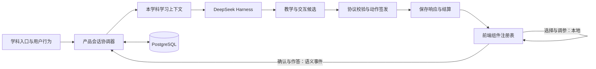

> 2026-11-19 范围变更：积分功能已移除，本文涉及积分、充值、扣费、退款及相关待确认事项均为历史设计，不再执行。当前状态以 README.md 为准。

# 问学：主动带学与动态交互 V1.2

2026-11-13 · 当前实现与后续边界

## 产品定位

用 DeepSeek Harness 的 Agent 运行方式，建设面向 C 端的中小学全年龄、全学科学习系统。目标体验来自用户观察到的 ChatGPT 学习模式：老师主动接手学习意图，根据学生的反应决定怎么教、怎么呈现，以及接下来做什么。这里描述的是本项目的工程实现，不推断 ChatGPT 的内部机制。

化学只是最初的交互示例。数学、语文、英语等学科使用同一套教学协议和交互机制，任何一个学科都不决定系统主流程。公司旧项目只借鉴分层、会话归属和业务持久化思路，不直接复用为 C 端底座。

## 用户的实际路径

1. 登录进入学习工作台，查看各科起点、最近会话与实际练习记录。
2. 点击学科，老师主动介绍学习方式和内容方向。首次只需确认这门课的起点，可以选择“暂时不确定”。
3. 老师建议从一个小例子开始，提供“跟老师开始学”“先用一道题看看起点”“帮我复习巩固”。直接选择即可，学生也能输入自己的目标或题目。
4. DSH 结合本学科阶段、当前目标、会话和作答证据，决定本轮教学内容及表达形式。可以只讲两句话，也可以组合说明、题卡、图示和演示。
5. 学生提交答案后先获得确定性反馈。答错保留原题并提供提示，答对后可继续下一小步或请求学习路线。一次正确作答不等于掌握整个知识点。
6. 随时追问。系统保留待答题，临时回复结束后可以“继续刚才的题”。新对话可以开始另一个学习目标，旧对话保留进度。

数学可以从高二开始、英语从高一开始、语文从初三开始。阶段不是全账户属性，也不是永久能力等级。具体难度还需要依据实际对话逐步调整。

## DSH 与产品层的职责



| 部分 | 职责 | 当前文件 |
| --- | --- | --- |
| Harness 适配 | 调用官方运行时，传入学科、阶段、待答任务、证据和近期对话 | `server/agent.js` |
| 教学配置 | 规定主动带学、按学科调整、允许打断、按需要选择交互；关闭系统工具 | `server/teaching.patch.yml` |
| 交互规划与协议边界 | 提供组件合同，校验模型候选，签发动作，剥离答案和非法字段 | `server/learning.js` |
| 业务协调 | 归属检查、幂等、版本校验、客观评分、状态事务与积分结算 | `server/index.js` |
| 持久化 | 用户、学科空间、产品会话、回合、学习状态、事件、响应和账本 | `server/schema.sql` |
| 交互呈现 | 按组件注册表渲染有序内容块；输入与拖动留在浏览器 | `src/learning.jsx` |
| 学科对话 | 主动开场、连续消息流、追问与原题恢复、学科历史 | `src/subject.jsx` |

Interaction Planner 是独立职责，并不要求额外调用一次模型。当前由 Harness 一次生成教学内容与呈现候选，服务端再校验。免费开场与确定性评分由规则生成响应。之后的教学内容不绑定固定课程状态机。

Harness 的运行会话与产品会话分开。当前每次付费回复启动临时运行会话，产品从数据库恢复必要上下文；未来可在保持用户与学科隔离的前提下引入运行池和更长的上下文记忆。

## 当前协议与组件

模型候选示例：

```json
{
  "version": "1.0",
  "topic": "阅读主旨",
  "blocks": [
    {"type": "text", "text": "先找出这些句子共同在说明什么。"},
    {
      "type": "choice",
      "prompt": "Trees cool streets and offer shade. They help make the air cleaner. What is the main idea?",
      "options": ["Trees only provide shade.", "Trees help make cities more comfortable."],
      "answer": 1,
      "hint": "找一个能涵盖几条信息的说法。",
      "explanation": "第二项概括了降温、遮阴和改善空气。"
    }
  ]
}
```

应用将候选规范化为 `{version, responseId, presentation, actions}`。题目实例和动作 ID 由服务器生成，标准答案与解析留在服务端状态中，答题之前不下发。`presentation` 只包含可显示的参数；服务端动作绑定会话和任务版本。

| 组件 | 当前能力 |
| --- | --- |
| `text` | 普通文字段落，支持短回复，不执行 HTML |
| `formula` | Unicode 公式文字，尚非 LaTeX 渲染 |
| `outline` | 学科方向和概念要点 |
| `level` / `options` | 每科学习阶段选择与老师建议的入口 |
| `choice` / `number` | 单选题和唯一数值答案题，一轮至多一道待答题 |
| `feedback` | 后端生成的正误结果、解析或提示 |
| `plan` | 模型提出的建议路线，不是已经验证的掌握结论 |
| `diagram` | 有限节点和有向边，由产品代码呈现关系 |
| `explorer` | 注册的分数长条、等比数列演示，参数取值有界 |

实现采用封闭字段校验函数，尚未引入通用 JSON Schema 校验库。未知组件和非法参数被丢弃；无任何可用内容或结构损坏则本轮失败并释放积分。普通文本回复可安全降级显示。一轮可包含多个内容块，前端不执行模型生成的 JavaScript、HTML 或 SVG。

## 事件、状态与计费

`learning_sessions` 持久化当前阶段、知识主题、待答题、近期作答证据、活动响应和版本。`learning_messages` 保存免费开场和确定性反馈，付费响应保存在 `turns.presentation`。两类消息按时间合并到同一条对话。

`POST /api/conversations/:id/learning-events` 接收 `requestKey`、`actionId`、`revision` 与 `value`。事务锁定会话，核对归属与当前动作，再判分、保存证据、更新版本和写入反馈。同一键相同载荷返回原结果；键冲突、过时版本和其他会话动作均被拒绝。

`POST /api/conversations/:id/turns` 接收自由文本，或当前响应中签发的老师动作。产品从数据库构建上下文后调用 Harness。生成结果要通过协议校验和版本检查，才提交为成功回复。待答题存在时，追问回复不得擅自替换题目。

| 行为 | 模型调用 | 积分 |
| --- | --- | --- |
| 进入学科、选阶段 | 无 | 免费 |
| 点选题目选项、输入数值、拖动演示 | 无，尚未提交 | 免费 |
| 提交客观题、确定性判分、原题重试 | 无 | 免费 |
| 请求老师讲解、继续、提示或规划 | Harness | 当前每次成功回复 2 积分 |
| 回复失败或没有可用交互内容 | 本轮失败 | 释放预留，不扣积分 |

每个模型按钮和输入框旁说明费用。学生可以自由提问，计费按回合执行，不按话题归类。模型不能修改钱包、账户或权限。真实充值与支付回调尚未实现。

## 已完成的验证

- API 验证 15 个学科的主动开场与独立阶段；数学高二会话与数学小学会话也可分别恢复。
- 浏览器分别验证数学数值题与本地演示、英语阅读选择题、语文概括选择题。使用同一条交互链路，没有单学科专属流程。
- 浏览器验证答错提示、重试、临时追问、刷新后恢复原题、正确反馈和学习路线。
- 浏览器验证拖动演示不产生 API 调用，桌面与 390px 手机布局无横向溢出、无 JavaScript 异常。
- API 验证重复提交、冲突载荷、过时动作、跨会话动作、账户隔离、答案不提前下发、积分账本和学习证据。
- 使用真实 Harness SDK 与运行时连接本地 Messages API 模拟服务，验证学科与证据上下文、结构化回复和工具关闭；非法组件使回合失败，已提交作答保留，预留积分释放。该验证不涉及真实模型教学质量。

本地检查脚本和截图位于忽略目录 `.local/qa`。构建使用 `npm.cmd run build`。

## 当前边界与下一阶段

当前交付的是可以运行的交互与 Harness 集成原型。默认离线模式的示例用于检验操作，不能替代真正的适应性教学；真实模型教学质量需要配置项目自己的 API 密钥后进一步验证。

客观评分按题目实例中的答案执行，能保证提交与结算一致；模型出的答案仍可能有内容错误。当前未接入审核题库、教材版本和授权知识图谱，不能宣称所有学段学科已完成内容覆盖或准确测量掌握度。后续应优先用授权知识点与审核题目约束生成，并进行跨学段教学质量评估。

后续还包括开放式作答评价、真实充值、生产 PostgreSQL 联调、长期学习记忆、学习路线落地为可追踪课程、LaTeX 排版及更多经过验证的学科组件。看板当前呈现实际阶段、会话与练习记录，不制造全年课程完成率。
