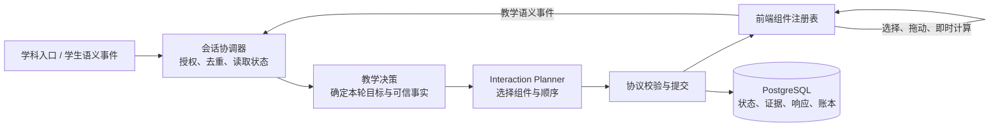

> 2026-11-19 范围变更：积分功能已移除，本文涉及积分、充值、扣费、退款及相关待确认事项均为历史设计，不再执行。当前状态以 README.md 为准。

# 苏格拉底式学习系统 · 动态教学交互架构 V1.1

> 历史评审稿。本文沿用截图学科作说明，不构成产品范围或实施优先级。当前全学科设计、实现边界和验收依据已由 [V1.2](./苏格拉底式学习系统-主动带学与动态交互-V1.2.md) 更新，不再采用单学科五题流程作为实施主线。

2026-11-12 · 评审稿

本文修订 V1.0 的教学引擎、对话协议和验收方案。应用继续按独立 C 端产品设计，采用官方 DeepSeek Harness 和 PostgreSQL，以「学习者 × 学科」保存学习空间，学科内有独立会话。高中化学用来验证交互链路，全学科和各学段使用同一套交互协议。

## 1. 现状评审

| 现有实现 | 体验问题 | 修订方向 |
| --- | --- | --- |
| 进入空会话显示输入框和示例问题 | 用户已点击学科，仍要自己编写第一条指令。新用户无法预知老师会怎样带学 | 进入学科触发系统事件。首次由老师说明学习节奏和内容范围，给出一个可以直接操作的选择 |
| Harness 适配只返回最终文本，前端逐条画聊天气泡 | 老师即使判断该出选择题或给示意图，也只能用文本描述 | 把模型输出视为教学与交互候选，后端校验后发布有序内容块 |
| 学科练习在侧栏里固定呈现，作答走学科级接口 | 练习游离在老师的反馈、下一题和具体会话之外 | 练习成为对话中的内容块，提交事件绑定当前会话、题目实例和版本 |
| 对话记录和题目正确性分别可存，缺少待完成教学任务的定位 | 追问后，系统没有可靠依据恢复到原题 | 独立记录活动、待答题目、答题证据和已提交的交互响应 |

[学科页现有入口与渲染](../src/subject.jsx#L137) · [Harness 最终文本接口](../server/agent.js#L49) · [现有练习提交接口](../server/index.js#L192)

截图体现的是外部行为。老师在用户表达宽泛目标后先铺垫，再询问学段，后续可以用分步解释和知识检查。下面的 Interaction Planner 和 LRP 是问学自己的实现设计。 [OpenAI 学习模式说明](https://openai.com/index/chatgpt-study-mode/)

## 2. 老师怎样接手第一步

**点击某个学科，就已经表达了学习意图。** 新用户进学科后，第一轮直接在会话区域显示老师的开场。用一句话说明会怎么学，列出这门课的几个主要方向，再给出此刻最需要学生决定的一件事。以截图中的高中化学为例，先介绍「讲解 → 例子 → 一起做题 → 纠错和总结」，简列基础概念、常见物质、反应原理等方向，然后呈现学段或学习目标的选择卡。学生点选即可继续。

进入学科的 `subject.entered` 事件由产品发出。引导按已知信息生成，已有该科学习阶段时可以直接确认学习目标，已有待答题时则恢复到那一道题。用户直接带题进入时，老师可以先用一问判断卡点，或直接开始分步讲解。每次只要求学生做一个明确决定，预设选项够用时用选择卡，开放回答需要表达理由时再使用输入框。

## 3. Interaction Planner 的边界



| 环节 | 输入 | 输出与责任 |
| --- | --- | --- |
| 意图理解 | 产品事件、学生文本、最近对话、当前任务 | 识别进入学科、提交、求提示、追问、继续或切换目标。明确的按钮事件直接采用其语义，开放文本可请模型分类 |
| 教学决策 | 当前活动与题目、已验证的作答、学段、目标和课程资料 | 给出本轮教学任务和可选下一步，例如确认正确后解释、针对误区给提示、进行迁移检查、总结 |
| Interaction Planner | 教学任务、可信事实、可用组件及能力、用户偏好、端能力 | 产出有序的内容块候选和动作引用。判断用一句话、选择题、公式、图示或模拟器，以及哪些应同时出现 |
| 校验与提交 | 组件候选、注册表、题目和内容版本、当前任务版本、积分上下文 | 绑定题目实例和服务端动作，校验后生成 LRP。评分和状态转换由后端决定，前端只消费已提交的响应 |

这几个环节是职责边界。确定性场景走规则和审核内容。开放解释时，Harness 可以在一次调用里提出教学策略、写解释、给组件候选，随后由应用逐项验证。无需为每个环节各发一次模型请求。教学任务只限制本轮允许做什么，同一知识点可以在一轮用公式，另一轮用数值题，学生追问时也可以只回一句话。

### Planner 的最小契约

- **输入**包括 `intent`、`taskSnapshot`、`verifiedFacts`、`availableContent`、`componentCapabilities`。组件能力包含可用名称、版本、用途和参数范围。上下文只取当前会话和该学科学习记录。
- **候选输出**包括 `pedagogy`、`blocks[]` 和 `suggestedActions[]`。候选可引用后端提供的题目、公式或图示模板，后端生成真实实例和动作 ID。模型无需接触标准答案、积分操作或其他会话的 ID。解释答题结果时，只提供该轮教学所需的已确认判分与事实。
- **校验与降级**先检查组件类型、版本、参数和大小，再核对引用是否存在、是否在当前课程与学段可用、动作是否允许改变当前任务。装饰或演示块不合法时可删去；承担答题的关键块失效时，换用已审核题卡或回到当前任务。保留已经确认的判分与证据。

## 4. Learning Response Protocol 草案

LRP 是产品自定义的 JSON 协议。每轮响应可以包含一个文本块，也可以包含多个有序组件。`actions` 只列出本轮允许触发的服务端操作，`focusActionId` 指出主要的下一步。组件通过引用绑定动作。提交后的响应按版本存入 PostgreSQL，用于刷新恢复和历史重放。

示例为「化学诊断第 3 题答对后」。第 3 题使用初稿中的配平例子，第 4 题和 ID 是评审示例。

```json
{
  "version": "1.0",
  "responseId": "lrp_003_feedback",
  "conversationId": "conv_chem_01",
  "task": {
    "id": "diag_chem_01",
    "revision": 7,
    "status": "awaiting_answer",
    "pendingQuestionId": "qi_004"
  },
  "pedagogy": {
    "intent": "answer_feedback",
    "strategy": "explain_then_check_transfer",
    "knowledgePointId": "chemical_equation_balancing"
  },
  "presentation": [
    {
      "id": "feedback_003",
      "type": "feedback",
      "v": 1,
      "props": { "attemptId": "att_003", "result": "correct", "text": "第 3 题答对了。" }
    },
    {
      "id": "reason_003",
      "type": "text",
      "v": 1,
      "props": { "text": "配平改的是式子前面的系数。逐个比较两边的原子数，就能检查是否配平。" }
    },
    {
      "id": "formula_003",
      "type": "math",
      "v": 1,
      "props": { "formulaRef": "eq_balanced_h2_o2_h2o" }
    },
    {
      "id": "demo_003",
      "type": "equation_balancer",
      "v": 1,
      "props": {
        "reactionRef": "rxn_h2_o2_h2o",
        "initialCoefficients": [2, 1, 2],
        "coefficientRange": [1, 6],
        "mode": "explore"
      }
    },
    {
      "id": "question_004",
      "type": "numeric_question",
      "v": 1,
      "props": {
        "questionInstanceId": "qi_004",
        "prompt": "按相同比例，生成 4 个水分子需要几个氧分子？",
        "inputKind": "positive_integer",
        "submitActionId": "submit_004"
      }
    }
  ],
  "actions": [
    {
      "id": "submit_004",
      "type": "answer.submit",
      "label": "提交答案",
      "target": "qi_004"
    }
  ],
  "focusActionId": "submit_004"
}
```

`feedback` 的正误来自后端评分，`equation_balancer` 的物种与计数来自审核数据，`numeric_question` 的题干和题目实例由内容服务填充。示例保留可选演示，老师可以在同样的答对场景省略演示块，或将下一题换成开放回答。公式、演示和题目先后顺序随教学需要调整，一轮最多突出一个待完成的作答动作。协议结构建议用 JSON Schema Draft 2020-12 校验，题目归属、动作有效期等依赖业务状态的约束由应用校验。 [JSON Schema 规范](https://json-schema.org/draft/2020-12)

## 5. 组件注册、渲染和事件回传

| 组件 | 参数来源和约束 | 行为 |
| --- | --- | --- |
| 文字与公式 | 短文本、安全 Markdown 子集或经校验的公式，支持审核内容引用 | 渲染。关闭原始 HTML，公式禁用可执行或可加载远程资源的扩展 |
| 学段与目标选择 | 当前学科适用的选项 ID、标签和下一步动作 | 点选是本地事件。确认后回传选项 ID，后端更新学科范围或教学目标 |
| 单选与数值题 | 版本化题目实例、可见选项、输入约束和提交动作 | 选项变更与输入是本地事件。点击提交后才判分、记证据 |
| 反馈与进度 | 评分结果、作答证据、活动快照 | 展示已确认状态，避免从模型文本推断正误或掌握度 |
| 学习报告与路线 | 证据汇总、目标和审核知识点引用 | 路线卡提供开始课程或复习等显式动作，保存时校验引用 |
| 示意图与参数化组件 | 审核资源引用或有限结构数据，例如节点、边和反应模板 | 前端用自有渲染器生成图形和即时状态。拖动、缩放、即时计算均在本地完成 |

注册表按 `type + v` 指定参数 Schema、渲染器、事件及资源引用规则。V1 的化学互动采用 React 组件和审核后的反应数据。通用示意图后续可以注册受控的 SVG 或 Mermaid 渲染能力，输入采用有限数据或审核资源。前端只运行已发布的组件代码。模型返回的 HTML、脚本、任意 SVG 或远程资源地址不进入渲染链路。

**事件通过服务端签发的动作引用回传。** 例如 `POST /api/conversations/{id}/learning-events` 接收下列语义事件。组件不会直接调用模型。

```json
{
  "requestKey": "19c80581-f38b-4d1c-84c8-96705fb54412",
  "responseId": "lrp_003_feedback",
  "actionId": "submit_004",
  "taskRevision": 7,
  "payload": { "value": 2 }
}
```

后端从会话和已提交响应查出事件类型及题目，校验操作者、响应归属、活动版本、动作是否仍有效和输入类型。同一幂等键和相同载荷返回原结果，载荷冲突则拒绝。两个标签页用不同键提交同一个已完成动作时，第二次拿到最新任务。老师主动开放重试时，签发新动作并更新任务版本，每次重试的证据单独记录。历史题卡可以回看，服务端只接受当前任务允许的动作。

## 6. 教学状态、临时意图和积分

- **教学任务**以会话内的 `learning_task` 表达，记录目标、范围、状态、待答题目实例和版本。学科空间仍保留总体目标与跨会话学习证据。一次客观提交增加一条证据，掌握度按规则推导。
- **当前对话意图**跟随回合事件。学生在第 4 题中途问「什么是 SVG」，可以直接得到一个文本块，`pendingQuestionId` 仍指向第 4 题。点击「继续原题」重现原题实例和已确认状态，不重发一题。用户明确切换学习目标时才暂停或结束原任务。
- **提交顺序**先在一个事务内校验题目版本、判分、保存作答与证据，并推进到已审核的下一题或待规划状态。若需要异步规划，给后续提交绑定任务版本。过时的模型候选只作废该候选，不能覆盖新进度。刷新先读取业务任务和最近已提交响应。旧文本会话可以以单一文字块回放。
- **计费**选学段、点击题卡选项、前端调参数、确定性判分和用已有内容反馈无需调用模型，均不扣积分。主动请求模型讲解或其他付费回合仍按现有约定预留，生成合格结果后结算，失败释放。自动诊断流程先用审核内容保证免费提交有完整反馈，避免学生仅点提交就发生意外扣费。

## 7. 端到端评审用例

截图和附件确认了开场方式、逐题诊断和诊断结束后的路线。下面的题目编排和文案是验收样例。

| 步骤 | 用户看到什么 | 后端如何处理 |
| --- | --- | --- |
| 首次进入高中化学 | 老师说明怎么学，介绍内容方向，给出学段或目标选择 | `subject.entered` 生成开场 LRP。已有明确起点时跳到下一个必要决定 |
| 选择高一并开始诊断 | 老师给第一道题卡，一次只展示一道待答题 | 创建诊断活动，发放版本化题目实例 |
| 提交第 1、2 题 | 先看到具体反馈，再按表现继续或得到一条提示 | 每次提交生成证据，弱项先记录为待确认；反馈和题目形式可随本轮任务变化 |
| 第 3 题选 B 并提交 | 显示答对，解释系数与原子守恒。可探索配平示意，下一步完成第 4 题 | 先判分、记第 3 题证据，再编排反馈、解释、公式、可选演示和第 4 题 |
| 调整配平系数或中途追问 | 原子计数即时更新。临时追问可以得到简短回复，随后恢复第 4 题 | 调整留在本地。临时回复单独入对话，第 4 题实例与任务版本保留 |
| 交完第 4、5 题 | 老师汇总本次做对与待巩固的范围，给出建议路线 | 从本次真实证据生成报告。学习路线引用审核知识点，点击后才创建学习任务 |

若第 3 题答错，可以返回已验证的正误反馈和一个针对性提示，例如让学生先检查氧原子数，再呈现原题的重试动作或补救小题。相同知识点可以用文字、公式、单选和数值检查，不把答错路径锁死为标准答案加下一题。

## 8. V1 最小范围与验收

**首个验证切片。** 先实现第 3 题已发放 → 提交 B → 后端判分 → 返回组合 LRP → 拖动本地演示 → 提交第 4 题。用这条切片确认业务事件、组件注册和恢复机制，然后补齐开场、第 1、2、5 题与诊断报告。首版注册文字/公式、学段选择、单选、数值输入、反馈、学习进度/路线和一个参数化组件。通用图形组件可以后续加入注册表。

| 验收项 | 通过条件 |
| --- | --- |
| 新人开场 | 从工作台点击学科后，老师直接介绍学习方式并提供可操作选项。无需输入提示词即可开始 |
| 动态编排 | 同一知识点至少有两种合适的呈现。第 3 题正确回合可组合反馈、公式、示意和下一题；简单追问只返回文字也可正常显示 |
| 答错补救 | 返回与答案相关的提示或补救题，保留待解决任务和证据 |
| 本地交互成本 | 反复调整系数时，原子计数即时更新，网络没有模型调用、学习提交或扣费请求 |
| 恢复与隔离 | 刷新、临时追问、切换学科后返回，仍能定位到原第 4 题；历史或其他会话的题卡不能替当前题作答 |
| 幂等与降级 | 重复提交只记一次。非法组件、无效引用或过时动作会被拒绝或安全降级。模型失败后已提交的作答和积分状态可核对 |
| 完整体验 | 在浏览器从首次进入跑完五题诊断，呈现报告和路线。用数据库核对事件、证据、任务版本和积分流水 |

本稿采用「规则优先，必要时由模型给候选」和「首次进入优先完成一个选择」作为设计默认值。组件版本、题目实例、待答任务以及积分回合的实际接口仍需在实现阶段验证。
