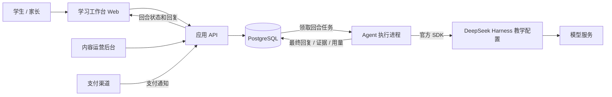

> 2026-11-19 范围变更：积分功能已移除，本文涉及积分、充值、扣费、退款及相关待确认事项均为历史设计，不再执行。当前状态以 README.md 为准。

# 苏格拉底式学习系统 · 整体架构设计 V1.0

2026-11-12 · 评审稿

## 1. 产品形态

面向小学、初中和高中的全学科学习工作台。用户登录后先看整体进展，再进入某个学科继续学习。以**学习者 × 学科**建立独立的学习空间，分别保存目标、教材章节、当前在学位置、掌握证据和会话。

| 入口 | 用户能做什么 |
| --- | --- |
| 学习工作台 | 查看各科最近学习、已验证的知识点、待复习项目和建议下一步，直接回到上次的会话或练习 |
| 学科空间 | 查看该科目标与进度，继续当前会话、回看历史或开启新会话。首次进入由老师主动介绍、确认该科阶段并给出带学起点；学生也可直接带题进入 |
| 账户和积分 | 查看可用积分、处理中预留积分、充值订单与消费记录 |
| 内容运营后台 | 管理学科目录、内容来源、知识点版本、题目审核和发布范围 |

**学科起点独立。** 例如数学在学高二数列，英语在学高一阅读，语文正在回补初三文言文。每科可指定自己的教材版本、目标和当前位置。一次答错可以触发临时回补，原学习位置保留为返回点。用户也可以随时修改该学科的目标。

**一个学科空间可有多条会话。** V1 进入学科时默认打开最近一条，也可以从历史里选一条，或按新问题另开一条。同科会话共享学习记录，模型上下文按会话隔离。跨学科切换后，只带入当前学科及所选会话的上下文。首页通过学习者身份汇总各科，点击任一条进度可回到对应位置。

**首页展示可解释的进展。** 学科卡片给出「当前在学」「最近验证掌握」「待复习」「下一步」。已有明确目标集合时，可以显示「已验证 6 / 目标 12」，计算范围随目标版本一起保存。全局卡片汇总活跃学科、近期学习和待复习数量。图谱暂未覆盖的主题仍能学习，首页可以显示会话和学习活动。

## 2. 总体架构

独立建设 C 端应用。公司项目提供服务端驱动 Agent、会话归属和业务数据独立存储的设计参考。运行层直接采用 DeepSeek Harness 官方上游的已发布版本，通过 SDK 和教学配置接入。

| 模块 | 职责 |
| --- | --- |
| 账户与权限 | 登录、学习者归属、监护关系、会话授权。账户代表登录与支付主体，学习者代表学习档案 |
| 学科与学习 | 学科目标、续学位置、练习、作答、掌握度和复习。提供首页看板查询 |
| 知识目录 | 教材版本、章节映射、知识点、先修关系、题目版本和发布状态 |
| 回合协调 | 校验请求、预留积分、创建任务、控制并发、处理结果和重连 |
| Harness 适配 | 管理运行会话、传入教学上下文、接收事件和结果、记录调用用量 |
| 支付与积分 | 充值订单、支付回调、积分预留和结算、退款与对账 |

首版建议用 React + TypeScript Web、Node.js / TypeScript 模块化后端和 PostgreSQL。应用 API 与 Agent 执行进程可从同一代码库部署，任务先用 PostgreSQL 可靠领取。后续可以单独扩容执行进程。前端只访问产品接口，Harness 端口、SDK 协议和模型凭据保留在服务端。

## 3. DeepSeek Harness 接入

1. **用官方 SDK 和教学专用 profile。** 选择一组匹配的已发布 SDK 与运行时版本，锁定依赖。教学配置组合模型、会话持久化和所需能力。首版可以由应用检索知识点并注入上下文，工具按需开放。教学配置采用白名单，关闭 Shell、通用文件访问和后台自主任务。
2. **应用持有会话映射。** PostgreSQL 保存产品会话 ID、学科空间归属、运行会话 ID、运行存储定位和恢复版本。浏览器只提交产品会话 ID。适配层先按登录身份校验会话归属，再定位运行会话。
3. **按回合关联结果。** SDK 的提示提交只确认入队，返回的消息 ID 用于关联后续事件。文档也说明会话空闲区间可能包含其他工作。首版每条会话只允许一个运行中的产品回合，使用受控的普通消息提交路径，结合入队回执和终态确认最终回复。用户文本始终作为消息内容，避免进入 SDK 的原生命令路由。
4. **续学位置由应用管理。** 有可读的运行日志时，使用选定版本支持的恢复接口。运行会话缺失或升级后无法恢复时，应用可用已确认的对话摘要、最近消息和学科状态开启新的运行会话，学生仍在原产品会话中。摘要视为上下文，学科进度与积分以 PostgreSQL 业务记录为准。
5. **容量先实测。** 初期使用有限数量的执行进程，给运行会话设置明确归属，同一运行会话同一时刻由一个执行者持有。SDK 的多会话并发、空闲回收、持久卷恢复和首字延迟通过技术验证确定。执行环境独立部署，便于更换或扩容。

[Harness 官方架构](https://deepseek-harness.github.io/deepseek-harness/reference/) · [TypeScript SDK](https://github.com/deepseek-ai/deepseek-harness/blob/master/packages/sdk/client/README.md) · [JSON-RPC 服务端](https://github.com/deepseek-ai/deepseek-harness/blob/master/packages/sdk/server/README.md)

## 4. 学习引擎与内容

### 苏格拉底式教学

每轮根据学科目标、当前位置、已有作答和学生请求，选一个主要教学动作。可用动作包括提问、给提示、换例子、直接讲解、布置变式题和建议复习。学生可主动切换动作，也可以只进行普通对话。小学低年级的默认表达更短、更具体，高中可以要求说明推理或论据。学科模板负责具体反馈方式，例如数学计算核对、英语阅读依据和语文表达量规。

学习状态由后端维护。一个学习活动可以处于「待作答」「反馈中」「待独立验证」「完成」，对话可在这些状态下随时继续。客观题按审核答案确定性判分，开放题用评分量规保存证据与评语。模型可以提出误区和下一步建议，掌握度由后端根据有效证据更新。记录独立作答、用了几级提示、是否完成变式题或延迟复习。单次答对可以写入作答记录，达到可配置的证据条件才标记掌握。

### 知识点与题库

用 `cn-math-taxonomy` 的目录、知识点粒度、教材映射、强弱先修边和诊断方式作为数据设计参考。获得适用的商用授权后批量导入已有内容，按学科和教材版本补齐缺口。该仓库标注 CC BY-NC 4.0，覆盖深度随学科而异，题目与先修强度也有审核局限。 [知识图谱与授权说明](https://github.com/xiaoyang111222/cn-math-taxonomy)

- **目录导入**按来源与发布版本记录外部 ID、授权、教材版本和审核状态。导入前检查重复 ID、缺失关联和先修环，保留旧 ID 映射，历史作答继续引用原有版本。
- **教材位置与掌握证据**分别保存。一个知识点可对应不同教材章节，避免换教材时丢失已有的掌握记录。弱先修用于提示和诊断，只有审核通过的规则可影响学习路径。
- **全学科的可用范围**由学科目录与内容覆盖共同决定。所有学科支持自由学习，有审核数据时再提供对齐教材的诊断、可量化进度和复习。图谱缺项时照常对话，学习记录可以保留为主题活动。
- **题库版本**记录题干、答案、评分规则和对应知识点。动态练习可以服务即时讲解，正式测评使用经过验证的题目与评分规则。

## 5. PostgreSQL 数据设计

| 领域 | 核心数据 | 关键约束 |
| --- | --- | --- |
| 用户 | `accounts`、`learners`、`learner_memberships` | 学习者归属与付款身份可独立表达。首版每个个人账号可默认有一个学习档案 |
| 学科空间 | `subjects`、`learner_subjects`、`learning_goals` | 学习者与学科组合唯一。目标、教材版本和续学位置都归属该空间 |
| 知识内容 | `curriculum_versions`、`knowledge_points`、`curriculum_mappings`、`prerequisite_edges`、`question_versions` | 保留外部 ID、内容版本、许可与发布状态。历史作答引用原题版本 |
| 学习记录 | `learning_activities`、`answer_attempts`、`mastery_evidence`、`mastery_records`、`review_items` | 作答和证据追加保存。掌握汇总可重算。证据和知识点归属同一学科学习空间 |
| 对话执行 | `conversations`、`messages`、`harness_sessions`、`agent_turns`、`agent_jobs`、`model_usage` | 会话归属学科空间。回合请求幂等，且同一会话只运行一个回合 |
| 支付积分 | `payment_orders`、`wallets`、`credit_holds`、`credit_entries` | 订单到账一次，每回合结算或释放一次，积分用整数记账 |

**写入规则。** 确定性判分后，作答、掌握证据和学习状态在一次事务中写入。若学生请求额外的 AI 讲解，则另走计费回合。模型超时、积分不足或浏览器断线时，已提交的作答仍可继续使用。首页先直接查询已提交的学习记录，数据量上来后再按需增加投影。

## 6. 积分与请求闭环

建议首版采用**预先展示固定积分价，按成功交付的 AI 回合扣分**。后台独立记录每次模型调用的实际用量、价格版本和失败重试成本。发送前展示本轮价格，读取历史、浏览知识点和可确定性判分的题目免费。充值兑换比例等用量实测后再定。 [DeepSeek 官方计价](https://api-docs.deepseek.com/quick_start/pricing/)

1. **充值。** 创建订单并固化金额与到账积分。收到支付通知后验签、校验订单和实付金额，同一事务内更新订单与追加积分入账流水。重复通知命中同一订单。退款按渠道结果和用户订单明细对账。
2. **发送。** 校验登录、会话归属、请求体和限流。锁定钱包余额，在同一事务内预留积分、保存消息、创建回合和执行任务。客户端重试携带同一幂等键，参数一致时返回原回合，参数不一致时提示冲突。
3. **执行。** 执行进程领取任务并持有租约。适配层限制输入长度、单次输出、回合模型调用次数和时长，所有可能产生上游费用的调用都计入回合预算。前端可接收进度及临时文本。
4. **结算。** 有效最终回复、回合成功状态和扣分流水一起提交。失败或超时终止时释放预留，标记回合失败并保留用户问题。只有成功提交的回复进入历史与学习证据。断线重连按回合 ID 查当前状态，成功结果可以直接取回。
5. **恢复与对账。** 若执行进程重启，回收过期租约并核对持久化运行记录。只有确认请求从未提交时才自动重发。运行结果无法确认时，保留待核对状态至规定时限，再关闭回合、释放预留并停用该运行会话映射。后续消息从已确认的业务历史恢复，迟到结果不得进入会话。提交终态时校验租约版本，通过唯一约束和事务确保同一回合只发生一次最终结算。

首版前端可通过 SSE 读取回合状态，以 `GET` 查询作为重连和刷新后的可靠恢复路径。业务接口建议覆盖首页看板、学科空间、会话及历史、发送与回合状态、作答、钱包、充值订单与支付通知。内容管理和支付通知使用独立权限入口。

## 7. 上线与验证

| 阶段 | 交付及验收 |
| --- | --- |
| 技术验证 | 锁定 Harness 版本，验证教学 profile、普通消息提交、回合终态、会话恢复和用量采集。在至少两个独立学习者之间验证会话隔离 |
| 工作台与学习闭环 | 支持全学科入口。用小学数学、初中英语和高中语文分别验证客观题、开放回答、知识图谱缺项三种场景。同一学习者各科位置独立，切换和刷新后可回到原会话 |
| 积分与商业验证 | 先用测试积分验证余额不足、同钱包并发、重复支付通知、断网、模型超时和执行进程重启。再接支付沙盒，验证充值、结算与退款对账 |
| 内容与运营 | 按授权导入并审核首批知识点，核对看板的目标与掌握统计。监控每回合成本、错误率、首字延迟、任务等待和预留积压 |

面向中国大陆未成年人公开运营时，建议将支付和学习身份区分，设计家长充值及消费查询。处理不满十四周岁学生的个人信息需要取得监护人同意并制定专门处理规则。设计数据保留与删除时覆盖 PostgreSQL、Harness 持久化会话和相关日志，监控默认用回合 ID 与计量指标定位故障。 [个人信息保护法](https://www.cac.gov.cn/2021-08/20/c_1631050028355286.htm)

## 8. 本稿的设计默认值

- 一个学科空间允许多条会话，默认恢复最近一条。首次进入由老师主动引导，学生通过简短选项确认起点；学生无需先编写提示词。动态交互以 V1.2 文档为准。
- 首版采用固定积分价和成功交付结算。充值档位、每轮价格、退款策略和付费上线地区待业务确认。
- 技术选型以模块化后端、PostgreSQL 任务表和独立 Agent 执行进程起步。Harness 的版本、运行资源规格和会话恢复能力以实测为准。
- 全学科学习从首版开放，教材对齐和可量化诊断的实际覆盖随授权与内容发布推进。
